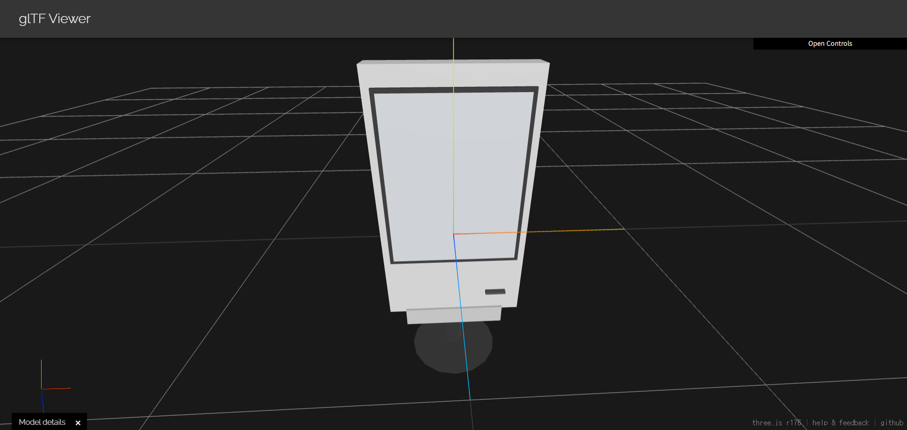
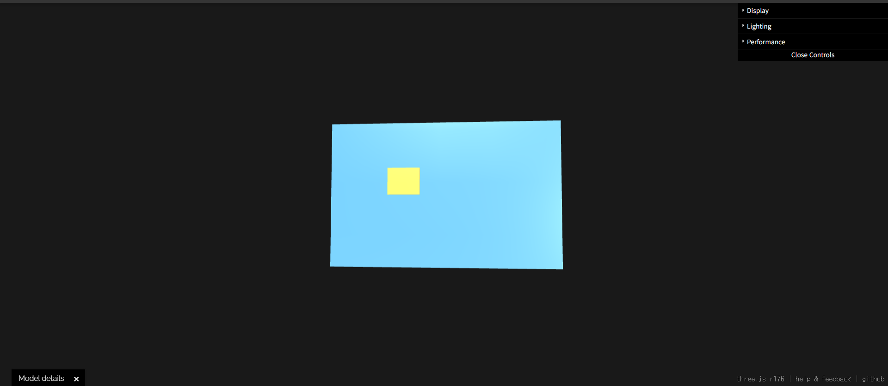
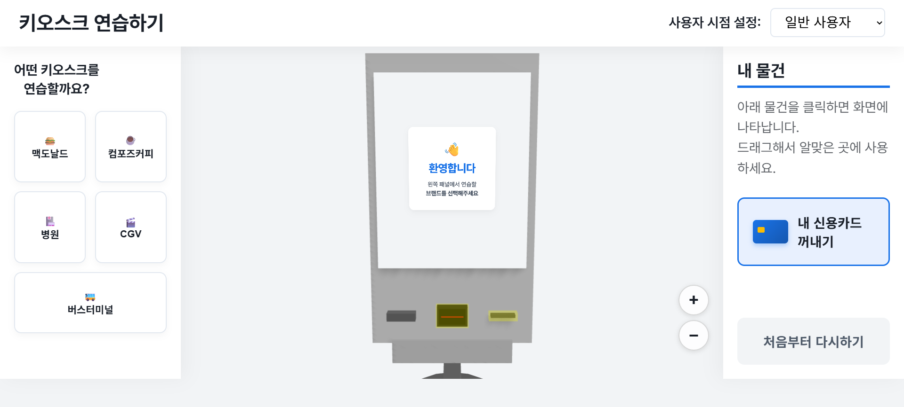
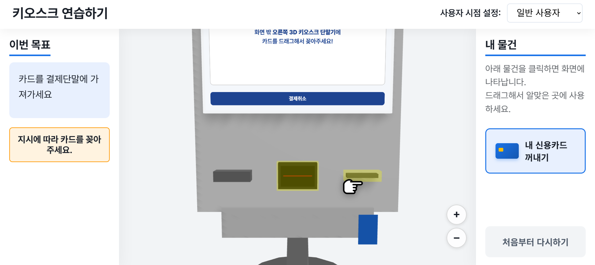

# 배리어프리 3D 키오스크 교육 시뮬레이터

2026 산학 캡스톤디자인 프로젝트

키오스크 사용이 익숙하지 않은 분들이 매장에 가기 전에 웹에서 주문과 결제를 미리 연습해 볼 수 있는 3D 키오스크 시뮬레이터입니다. 화면 속 키오스크를 직접 누르고 카드를 단말기에 꽂은 뒤 영수증이나 승차권을 받는 과정까지 실제와 비슷한 흐름으로 따라 해볼 수 있습니다.

## 개요

웹 브라우저에 Three.js로 만든 3D 키오스크 기기를 띄우고 그 화면 안에 실제 매장 키오스크를 본뜬 UI를 넣었습니다. 사용자는 연습하고 싶은 매장을 고른 뒤 안내 문구를 따라 단계별로 주문을 진행합니다.

| 3D 키오스크 모델 | 3D 신용카드 모델 |
| :---: | :---: |
|  |  |
| 화면과 결제 단말기와 출력구로 구성된 키오스크 본체 | 결제 단계에서 끌어서 단말기에 꽂는 카드 |

연습할 수 있는 키오스크는 다섯 가지입니다.

- 맥도날드: 햄버거 메뉴 선택과 주문
- CGV: 영화 예매와 좌석 선택
- 컴포즈커피: 음료 주문
- 고속버스터미널: 승차권 발매
- 충남대학교병원: 수납과 처방전 발행

진행 중에는 지금 해야 할 일을 화면 상단에 문장으로 알려주고 눌러야 할 위치를 화살표로 표시합니다. 결제 단계에 들어가면 카메라가 결제 단말기 쪽으로 자동으로 확대됩니다. 카드를 마우스로 끌어 단말기에 꽂아야 다음 단계로 넘어가며 결제가 끝나면 영수증이나 승차권이 출력되는 모습까지 보여줍니다.

## 기획 의도

요즘은 식당과 카페는 물론 영화관과 터미널과 병원까지 대부분의 접수와 결제가 키오스크로 바뀌었습니다. 하지만 고령층이나 디지털 기기에 익숙하지 않은 분들에게는 뒤에 사람이 기다리는 상황에서 처음 보는 화면을 조작하는 것 자체가 큰 부담입니다. 키오스크 앞에서 망설이다 주문을 포기하는 경우도 적지 않습니다.

저희는 이런 부담을 줄이려면 실수해도 괜찮은 환경에서 충분히 연습해 보는 것이 가장 효과적이라고 생각했습니다. 그래서 평면 화면을 클릭하는 방식 대신 실제 기기처럼 생긴 3D 키오스크를 보면서 카드를 꽂고 영수증을 받는 동작까지 직접 해볼 수 있도록 만들었습니다. 매장마다 화면 구성이 다른 것도 어려움이 되기 때문에 자주 이용하는 업종별로 실제와 비슷한 화면을 따로 구현했습니다.

## 주요 기능

- **3D 키오스크 화면:** Three.js로 만든 3D 기기 안에 CSS3DRenderer로 각 매장의 HTML 화면을 띄워 실제 기기를 조작하는 것처럼 보여줍니다.
- **단계별 안내:** 현재 해야 할 일을 문장으로 안내하고 눌러야 할 버튼 위치에 화살표 가이드를 표시합니다.
- **카메라 자동 확대:** 진행 단계에 맞춰 카메라가 필요한 부분으로 자동으로 이동합니다. 확대와 축소 버튼으로 직접 조절할 수도 있습니다.
- **카드 결제 체험:** 3D 카드를 마우스로 끌어 결제 단말기에 꽂는 동작으로 결제를 진행합니다.
- **출력물 체험:** 결제 후 출력된 영수증과 승차권 같은 출력물을 집어서 보관하는 과정까지 연습할 수 있습니다.
- **화면 간 통신:** 각 매장 화면(iframe)과 3D 화면은 postMessage로 안내 문구와 진행 상태를 주고받습니다. 허용된 출처에서 온 메시지만 처리하도록 검증합니다.

## 시연 화면



왼쪽에서 연습할 키오스크를 고르면 가운데 3D 키오스크에 해당 매장 화면이 나타납니다. 오른쪽 내 물건 영역에서 신용카드를 꺼낼 수 있습니다.



결제 단계에서는 카메라가 단말기 쪽으로 확대되고 왼쪽 이번 목표에 해야 할 일이 표시됩니다. 손가락 가이드가 가리키는 결제 단말기에 카드를 끌어다 꽂으면 결제가 진행됩니다.

## 기술 스택

- JavaScript
- Three.js / CSS3DRenderer
- Vite
- HTML / CSS

## 팀원 구성

| 이름 | 역할 | 담당 업무 |
| :---: | :---: | --- |
| 박혜빈 | 팀장 · 기획 · 개발 | 프로젝트 기획 및 충남대학교병원 키오스크 UI 개발 |
| 고은환 | 개발 | 플랫폼 구성(프론트엔드·백엔드 개발) / 각 브랜드 화면 연동 구성 / 고속버스터미널 키오스크 UI 개발 |
| 정지훈 | 개발 | CGV 키오스크 UI 개발 |
| 황선근 | 개발 | 컴포즈커피 키오스크 UI 개발 |
| 임재호 | 개발 | 맥도날드 키오스크 UI 개발 |

## 실행 방법

[Node.js](https://nodejs.org/)가 설치되어 있어야 합니다.

```bash
cd kiosk-3d-app
npm install
npm run dev
```

실행 후 브라우저에서 `http://localhost:8888`로 접속하면 됩니다.

## 상표 및 이미지 안내

이 프로젝트는 대학 캡스톤디자인 수업의 학생 프로젝트로 비상업적인 교육 목적으로 제작되었습니다. 화면에 사용된 각 브랜드의 상호와 로고 및 제품 이미지는 실제 키오스크 환경을 재현하기 위해 학생 프로젝트에 한하여 사용했으며 그 권리는 해당 회사에 있습니다. 이 프로젝트는 해당 회사들과 관련이 없습니다.
